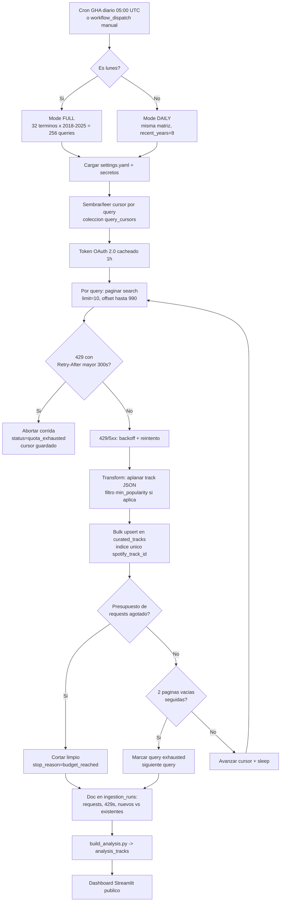

# Flujo del pipeline ELT

> Fuente viva de este diagrama. El archivo anterior `pipeline-flow.mmd`
> (texto plano, GitHub no lo renderizaba) fue reemplazado por este `.md`.

## Cómo crece el dataset

- Cada query tiene un cursor (`next_offset`) que apunta a la primera página
  **no pedida**. Una corrida nunca relee terreno conocido.
- El pipeline anterior se detenía en el offset 490: toda query ya ejecutada
  reanuda en 500, donde la novedad medida es de 85-100%.
- Presupuesto: `request_budget` (400) requests por corrida, un solo job.
  Rendimiento medido: ~6-7 tracks nuevos por request.

## Reglas verificadas contra la API (2026-09)

- `limit=10` máximo aceptado (`>10` da `400 Invalid limit`).
- `offset` máximo útil 990 (`offset + limit <= 1000`).
- Una página corta **no** significa fin de resultados: Spotify devuelve
  páginas incompletas a mitad de camino. Solo se marca `exhausted` tras 2
  páginas vacías consecutivas.
- `popularity` llega nulo en search y `/v1/tracks` da `403`: el filtro por
  umbral está implementado pero inactivo (`min_popularity: 0`).
  Detalle en `docs/data-source.md` §19.
- Endpoints bloqueados (403) en Development Mode: `/v1/tracks?ids=`,
  `/v1/albums?ids=`, `/v1/artists?ids=`, `/v1/playlists/{id}/tracks`.
  Sí funcionan: `/v1/search`, `/v1/albums/{id}`, `/v1/albums/{id}/tracks`
  (`limit=50`).
